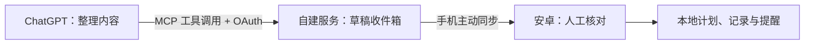

# ChatGPT 接入自建 MCP：从 OAuth 发现到工具调用的排障实录

文档路径：`docs/ai-tools/mcp/chatgpt-mcp-oauth-troubleshooting.md`

更新日期：2026-10-21。案例来自 Mediary 接入 ChatGPT 的实际排障，源码基线为 Mediary `v0.2.6`。本文保留可复用的判断方法，示例域名均为占位地址，不包含真实入口、口令、令牌或业务原文。

## 1. 这篇文档解决什么问题

自建服务已经部署，浏览器也能打开，但 ChatGPT 仍然出现以下问题：

- `Couldn't discover OAuth settings. Check the server URL or enter settings manually`。
- 授权页返回 `请求来源不被允许`。
- 填好口令，点击授权后仍停留在输入框。
- 回到 ChatGPT 显示认证成功，接着出现 `action discovery failed`。
- 插件已经存在，但聊天回复“工具列表中没有找到 get_sync_status”。

本文以 HTTP MCP 服务为主。先确认故障停在哪一层，再改对应配置；不要把所有问题都归为网络、套餐或 API Key，也不要反复重装来替代定位。

## 2. 先分清这条链路

Mediary 是个人用药记录工具：ChatGPT 通过 MCP 保存待核对草稿，手机主动同步，由用户核对后保存本地计划。已确认提醒由安卓本地负责。



本案例不在业务服务端再次调用模型 API，因此不需要给 Mediary 配置模型 API Key。ChatGPT 负责当前会话的模型调用，MCP 服务负责执行业务工具；账号能否添加和使用自定义连接，应以实际客户端入口和工作区权限为准。

把接入拆成六个独立检查点：

| 检查点 | 通过的证据 | 还不能证明什么 |
| --- | --- | --- |
| 公网入口 | 客户端能访问正确 HTTPS 路由，TLS 校验通过 | OAuth 元数据正确 |
| OAuth 发现 | 能取得资源和授权服务器元数据，URL 一致 | 用户授权已完成 |
| 用户授权 | 授权码兑换成功，客户端取得有效令牌 | 工具目录已扫描成功 |
| 工具发现 | `tools/list` 返回目标工具及正确 schema | 当前聊天已经选择该连接 |
| 工具执行 | 选中连接后，服务返回该工具的实际结果 | 手机已同步或保存 |
| 业务落地 | 手机领取、核对、保存均有对应证据 | 操作系统通知实际送达 |

## 3. 按症状找入口

| 现象 | 优先检查 | 下一步 |
| --- | --- | --- |
| OAuth settings 发现失败 | 完整 MCP URL、TLS、挑战头、两类元数据及反向代理路径 | 按第 4 节逐跳检查 |
| 手动填 Client ID 后仍是发现错误 | 手动区域是否只配置客户端身份，元数据是否仍缺失 | 先修发现，不反复换 Client ID |
| 授权页 403、来源不允许 | 浏览器实际发送的 `Origin`，是否为 `null` | 对照第 5 节检查 Referrer Policy |
| 点击授权后原地不动 | 表单是否 POST、POST 状态码、浏览器 CSP 拦截 | 区分来源校验失败与 303 导航被拦 |
| 认证成功但 action discovery failed | 保存的服务器地址是否漏了工具传输路径 | 对本案例核对结尾 `/mcp` |
| 聊天说找不到工具 | 详情页的实际地址、连接状态、工具缓存、当前聊天是否选择插件 | 刷新元数据，开新对话复测 |
| 刚连上可用，过一段时间再次要求连接 | 实际授予的 scope、refresh token、刷新与撤销逻辑 | 按第 7 节核对续期 |
| ChatGPT 创建草稿成功，手机没有计划 | 手机是否主动同步、人工核对并保存 | 转查业务链路，不继续修改 OAuth |

聊天中的“没有找到接口”只是客户端侧现象，未必有请求到达服务器。它不是服务器返回的 401，也不能直接证明口令错误。

## 4. 从公网入口查到工具目录

以下命令使用 PowerShell 7 和 `curl.exe`，默认只访问公开健康信息、发现元数据及工具定义。先把占位域名替换成自己的地址；不要把真实令牌写进命令历史或示例文件。

### 4.1 明确基础地址和 MCP 地址

```powershell
$base = 'https://mcp.example.com'
$mcp = "$base/mcp"

# /health 是 Mediary 的健康接口，不是 MCP 的统一要求。
curl.exe --silent --show-error --max-time 15 -i "$base/health"

# 本案例中，匿名 GET 应返回 401，并携带发现挑战头。
curl.exe --silent --show-error --max-time 15 -i $mcp
```

本案例的成功判断：健康接口返回 200，响应为 JSON；匿名 `GET /mcp` 返回 401，`WWW-Authenticate` 中有 `resource_metadata`。401 在这里是预期的发现入口，不是服务宕机。

`/mcp` 是 Mediary 选择的传输路由，不是所有服务必须使用的固定后缀。真正应填写的是目标服务暴露的完整 MCP endpoint，而不是首页或 OAuth 授权页。

如果业务部署在路径前缀下，则分别是：

```text
手机基础地址：https://mcp.example.com/mediary
ChatGPT MCP：https://mcp.example.com/mediary/mcp
```

### 4.2 沿挑战头检查元数据

先复制 `WWW-Authenticate` 中公开的 `resource_metadata` 地址，再读取它，不要只猜 well-known 路径。

```powershell
# 此处使用 Mediary 根路径部署的示例；应替换为实际挑战头提供的 URL。
$resourceMetadata = 'https://mcp.example.com/.well-known/oauth-protected-resource'
curl.exe --silent --show-error --max-time 15 -i $resourceMetadata

# 再检查 authorization_servers 中对应 issuer 的发现入口。
curl.exe --silent --show-error --max-time 15 -i "$base/.well-known/oauth-authorization-server"
```

对照响应检查以下关系，不要只检查“是否返回 200”：

- 资源元数据的 `resource` 对应实际 MCP 资源标识；Mediary 使用完整 MCP URL。
- `authorization_servers` 指向正确 issuer；授权服务器元数据中的 `issuer` 与它完全一致。
- `authorization_endpoint`、`token_endpoint` 和所选注册方式对应的入口均可访问。
- 本案例使用 DCR 与 public client：注册入口可用，token endpoint 支持 `none`，PKCE 支持 `S256`。
- 授权、令牌和业务请求使用同一公开资源身份，不混用内网地址、旧隧道域名或旧路径。

这几项与 [OpenAI 官方认证要求](https://developers.openai.com/plugins/build/auth) 一起核对。DCR 是本案例的选型；其他服务可以按实际能力使用 CIMD 或预注册客户端，不能把示例当成所有服务的唯一方案。

如果 issuer 带 `/mediary`，还要检查代理是否处理了带路径的发现入口。Mediary 的 Nginx 示例同时覆盖：

```text
/.well-known/oauth-authorization-server/mediary
/.well-known/oauth-protected-resource/mediary/mcp
```

部分兼容别名位于站点根或应用前缀下。以实际发现请求和响应中声明的 URL 为准；共享一个站点时，不能用本应用的兼容路由覆盖另一个 OAuth issuer 的发现入口。对应实现见 [Mediary 路径前缀代理示例](https://github.com/yunko1993/mediary/blob/ab2982832ee32ce08ec205e70e57fa4871f9111f/server/deploy/nginx-prefix.conf.example)。

### 4.3 核对传输、初始化和工具目录

Mediary 使用无会话的 Streamable HTTP，POST 返回 JSON。客户端仍需在 `Accept` 中声明 JSON 和事件流；并不意味着本实现一定会开启 SSE 长连接。

```powershell
$initialize = '{"jsonrpc":"2.0","id":1,"method":"initialize","params":{"protocolVersion":"2025-06-18","capabilities":{},"clientInfo":{"name":"manual-diagnostic","version":"1"}}}'
$tools = '{"jsonrpc":"2.0","id":2,"method":"tools/list","params":{}}'

$initialize | curl.exe --silent --show-error --max-time 15 `
  -H 'Content-Type: application/json' `
  -H 'Accept: application/json, text/event-stream' `
  --data-binary '@-' $mcp

$tools | curl.exe --silent --show-error --max-time 15 `
  -H 'Content-Type: application/json' `
  -H 'Accept: application/json, text/event-stream' `
  -H 'MCP-Protocol-Version: 2025-06-18' `
  --data-binary '@-' $mcp
```

`2025-06-18` 是 Mediary 支持的版本之一，不代表最新协议；换服务时使用其实际支持的版本。其他有会话的实现还可能要求保存 `Mcp-Session-Id`、发送初始化完成通知等，应使用 MCP Inspector 完整验证。

本实现允许匿名初始化和查看工具定义，但任何业务工具调用都检查 OAuth。其他服务可能要求从初始化起就鉴权，出现 401 时应完成授权后再继续，不能照搬匿名策略去开放私有数据。

判断成功时检查 JSON-RPC 的 `result` / `error` 和工具列表，而不只看 HTTP 200。拿到 HTML 首页、代理错误页、重定向或 404，应返回检查完整路由。

### 4.4 本机可访问，不代表 ChatGPT 可访问

本次曾在直接使用公网 IP 的入口持续遇到发现错误，换用临时 HTTPS 隧道后进入了授权页。这个对照说明换入口能推进排查，但同时改变了域名、TLS、代理和网络路径，不能单独证明“ChatGPT 一律不支持 IP 地址”。

同样，本机和某个 SDK 都成功，也不能替代实际 ChatGPT 账号的验证。需要结合客户端错误、服务器收到的请求阶段、TLS 与代理响应一起判断。

临时隧道接通前，应确认流量路径：本次 Cloudflare 隧道会中转 OAuth 与业务流量，并非只提供域名。示例和日志不保留真实入口或凭据。长期使用应准备可维护的稳定入口；重新创建临时隧道后，应重新核对公开地址，而不是假定旧地址继续可用。

## 5. 授权页：区分来源失败与浏览器导航失败

本次出现过两类不同拦截，肉眼都可能表现为“口令输入了但连接没成功”。

### 5.1 `请求来源不被允许`

服务检查了 `Origin`。当授权 HTML 使用 `Referrer-Policy: no-referrer` 时，本次浏览器表单请求出现 `Origin: null`，与服务的来源白名单不匹配，导致 403。

排查顺序：

1. 从 ChatGPT 新发起一次 Connect，不复用过期授权页。
2. 在浏览器 Network 中确认表单是否真的发起 POST。
3. 只在本机查看 `Origin` 和响应状态，勿导出带 Cookie、口令或授权参数的原始请求。
4. 核对授权 HTML 的 Referrer Policy、表单 action 与服务来源检查。

本案例将授权页的策略调整为 `same-origin`，保留同源提交所需的来源信息；跨站回调响应仍使用 `no-referrer`。这是一组需要在浏览器里验证的组合，不能简单把 `null` 或任意来源加入白名单。

### 5.2 POST 已返回 303，但仍留在授权页

另一次排查中，后端已接受口令并生成授权码，浏览器却未完成回到 ChatGPT 的导航。本次 Chromium 对表单后的 303 跳转执行了 `form-action` 检查，原先只允许 `'self'` 的 CSP 拦住了回调。

定位时同时看：

- POST 是否返回 303，Location 是否为本次已校验的 ChatGPT 回调；不要复制包含 code 和 state 的完整 URL。
- 浏览器 Console 是否报告 CSP 的 `form-action` 拦截。
- 服务的授权成功记录，与浏览器最终停留位置是否一致。

Mediary 的处理是只允许本站与本次已经通过注册白名单、精确匹配校验的回调地址，例如：

```http
Content-Security-Policy: default-src 'none'; form-action 'self' https://chatgpt.com/connector_platform_oauth_redirect; frame-ancestors 'none'; base-uri 'none'
```

真实回调应使用连接管理页展示的完整地址，而不是照抄上面的示例；可能是稳定回调，也可能带 callback ID。不能放行任意 HTTPS 域名或取消整条 CSP。这里讨论的是 OAuth 授权页面，不是 MCP Apps 组件的 CSP。

后端的普通 HTTP 测试不会执行浏览器 CSP。`POST /oauth/authorize` 返回 303，只能证明后端这一步通过，仍需实际浏览器完成导航。

## 6. 认证成功，为什么还找不到工具

### 6.1 本次最直接的原因：地址漏了 `/mcp`

实际遇到过的配置是只保存了站点根地址。OAuth 发现入口在站点根路径仍可访问，因此能完成授权；但后续工具扫描发往根路径，真正的 MCP 处理器却在 `/mcp`，最终出现 `action discovery failed`。

修正完整 endpoint 后，工具调用才成功。这说明“认证成功”与“工具发现成功”必须分开验收。

### 6.2 服务器更新，不会自动更新聊天中的工具目录

本案例在 ChatGPT 中按下面顺序核对：

1. 打开连接详情，按保存的服务器 URL 区分同名连接和旧隧道连接。
2. 检查是否仍显示 Connect；“插件在列表里”不代表当前账号已授权。
3. 对自定义连接执行 Refresh，检查返回的工具元数据。
4. 开新对话，用 `@` 选择正确连接。
5. 先运行一个明确的只读请求，例如“查看手机同步状态，只调用 get_sync_status”。

不要在旧地址和旧授权页之间反复重试。官方当前的 [连接与刷新流程](https://developers.openai.com/plugins/deploy/connect-chatgpt) 也要求刷新元数据后开新对话复测；页面名称和可见入口会随客户端及工作区策略变化。

如果 `tools/list` 正常，而 ChatGPT 没有实际调用，可以继续检查工具是否启用、描述是否清楚、当前聊天是否选择了连接。不要因此先关闭服务鉴权。

## 7. OAuth 接通以后还要检查什么

### 7.1 让需要登录的工具正确触发授权

Mediary 同时提供资源元数据、每个工具的 OAuth 声明，以及未授权调用时的登录挑战。仅有一个授权网页，不足以让聊天客户端知道该在何时引导连接。

本例的工具声明为 `securitySchemes: [{ type: 'oauth2', scopes: [...] }]`；未授权工具结果使用 `isError` 和 `_meta["mcp/www_authenticate"]`，挑战包含资源元数据 URL、所需 scope、`error` 与 `error_description`。HTTP 200 也可能包着这类需要授权的工具结果，诊断时要继续检查结果内容。官方说明见 [触发认证界面](https://developers.openai.com/plugins/build/auth#triggering-authentication-ui)。

OAuth client ID、client secret、服务访问口令与 access token 各有用途。本案例使用 public client，不需要 client secret；手动填一个 client ID 不能补上缺失的发现配置，更不能把服务口令当成 OAuth client secret。

### 7.2 自动保持连接取决于实际授权

本案例的 access token 有效期为一小时；只有实际申请并授予 `offline_access`，才签发刷新凭据。这是 Mediary 的配置，不是所有 MCP 服务统一的有效期或续期规则。

曾经只修改发现元数据，工具声明仍未申请续期权限。后续需要把资源声明、工具所需 scopes 和授权挑战一并核对，并重新授权已有连接。刷新工具目录不等于扩充旧令牌的权限。

还需用合成凭据验证：只读令牌不能写入、刷新会轮换凭据、撤销后不可用、客户端和令牌摘要在重启后仍然存在。遇到 `invalid_client` 应核对原注册客户端是否丢失，不能将它一概当成 access token 过期。[OpenAI 官方排障说明](https://developers.openai.com/plugins/deploy/troubleshooting#authentication-problems)

### 7.3 这次代码审查补出的两个问题

- 匿名注册若永久占用固定名额，可阻断后续真实连接。Mediary 现在为未授权注册设置期限，容量不足时回收未授权申请，保护已获准连接；不能直接删除所有客户端来“重置授权”。
- 刷新请求要求缩小 scope 时，必须使用实际缩小后的权限签发令牌。不能只验证它是子集，再把原有写入和续期权限签回去。

这些结论来自本项目代码审查与最小复现，不代表必须自写 OAuth。可复用的新项目应优先评估成熟 SDK 和身份服务；本案例的手写实现服务于个人受限场景。

## 8. 业务同步与安全诊断

工具调用成功以后，Mediary 仍然需要手机同步、人工核对、明确选择用药人并保存。本地保存失败要检查日期、钟点、字段校验和数据库，不继续改 OAuth。

诊断日志采用固定事件字段：

```json
{"event":"mediary_mcp_diagnostic","at":"2026-10-21T00:00:00.000Z","route":"mcp","method":"POST","operation":"tools_list","outcome":"success","status":200}
```

可记录时间、固定阶段、方法、结果类别和状态码。不能记录 Authorization、Cookie、请求正文、原始 OAuth 查询串、授权码、令牌、访问口令或业务原文。不要直接输出整个 request、error 或工具结果；代理和隧道层同样需要检查日志配置。

阶段判读示例：

- `tools_list / success`：服务返回过目录，不代表聊天已安装成功。
- `auth_required`：工具要求授权，不代表业务工具已执行。
- `authorize / POST / 303`：后端授权步骤完成，不代表浏览器已回到 ChatGPT。
- `token / 200`：令牌兑换完成，不代表工具扫描成功。
- 特定 `tool_* / success`：对应工具执行成功，再按业务定义检查后续落地。

## 9. 一条可交给下次 AI 执行的排障指令

```text
按本文对我指定的 MCP 服务做只读排查。
先确认实际 MCP URL、匿名响应与发现挑战，再检查资源元数据和授权服务器元数据，
然后检查初始化、tools/list、ChatGPT 连接状态和当前聊天选择。
每一步给出响应阶段、判断依据，以及失败后应查的下一层。
不要把本机成功等同于 ChatGPT 可访问，也不要凭通用错误断言平台不支持 IP。
不要创建业务数据、反复注册客户端、撤销授权或修改线上配置。
不要读取或输出私有口令、密钥、令牌、Cookie、授权码和业务正文。
如果必须复现浏览器授权，让我在页面本地输入口令，只记录脱敏后的状态与错误类别。
需要调整配置时先准备具体差异；实际写操作遵循当次用户授权范围。
```

## 10. 验收与后续维护

- 公开 HTTPS 路由和元数据通过；通过实际 ChatGPT 完成一次授权与工具调用。
- 使用明确只读工具先验证连接，再由用户授权创建一条合成业务数据并核对落地。
- 分别保留“工具发现、授权、工具调用、手机保存”的验证结果，不用一个“连接成功”覆盖所有阶段。
- 负向测试覆盖未授权、权限不足、错误 resource、重复请求、过期令牌与重启后的客户端保留。
- 改地址、发现元数据、工具定义或 scope 后，重新检查连接缓存和已有授权。
- 更改容器环境变量时需要更新容器配置；单独 restart 不会重新注入 `.env`。所有操作保留现有持久化卷。

本文沉淀的是一次接入案例与排查方法，不承诺所有账号入口、客户端版本和部署环境都相同。已有实际证据不足时，应记录“尚未定位”，而不是写成平台限制。

## 11. 参考与案例代码

- [OpenAI：连接和测试自定义 MCP](https://developers.openai.com/plugins/deploy/connect-chatgpt)
- [OpenAI：OAuth 认证要求](https://developers.openai.com/plugins/build/auth)
- [OpenAI：MCP 服务构建与部署](https://developers.openai.com/plugins/build/mcp-server)
- [OpenAI：故障排查](https://developers.openai.com/plugins/deploy/troubleshooting)
- [Mediary 接入文档：v0.2.6 源码快照](https://github.com/yunko1993/mediary/blob/ab2982832ee32ce08ec205e70e57fa4871f9111f/docs/mcp.md)
- [Mediary MCP 路由与授权页响应策略](https://github.com/yunko1993/mediary/blob/ab2982832ee32ce08ec205e70e57fa4871f9111f/server/src/mcp.mjs)
- [Mediary OAuth 与续期实现](https://github.com/yunko1993/mediary/blob/ab2982832ee32ce08ec205e70e57fa4871f9111f/server/src/oauth.mjs)
- [Mediary 脱敏诊断事件实现](https://github.com/yunko1993/mediary/blob/ab2982832ee32ce08ec205e70e57fa4871f9111f/server/src/diagnostics.mjs)

本文未重新执行真实账号授权或重新创建临时隧道；连接过程依据当时会话中的实际结果和对应实现整理。2026-10-21 核对了上述 OpenAI 官方页面；后续 UI 或协议要求变化时，应更新本篇，而非继续套用旧截图或旧回调地址。
